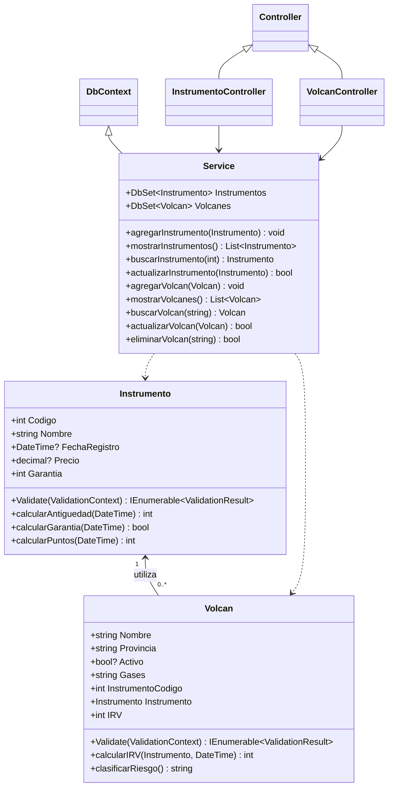
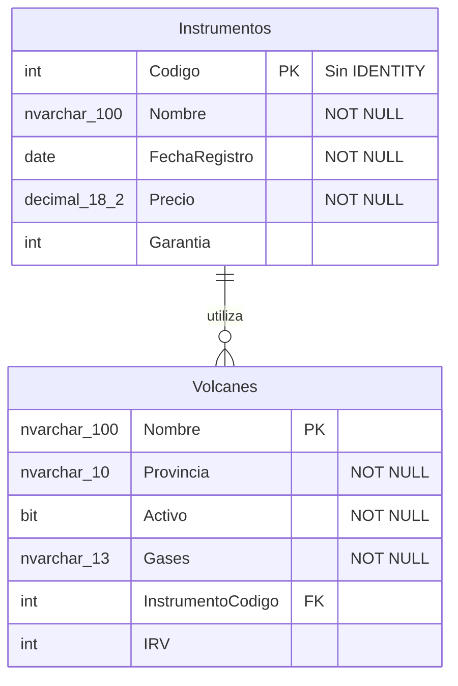
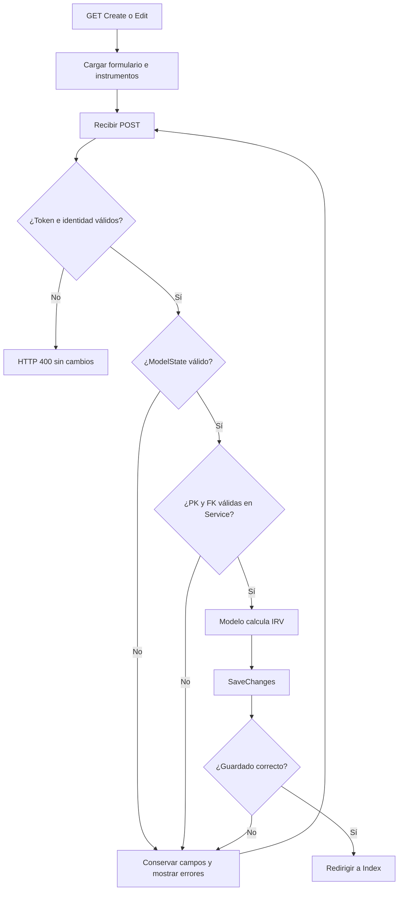

# Semana 8 — Cherkessia

Aplicación académica de Programación II para registrar instrumentos especializados y volcanes, calcular antigüedad y garantía, y calcular el índice de riesgo volcánico (IRV) antes de guardar. Conserva ASP.NET Core MVC, .NET 8 y Entity Framework **6.5.2** de Zara. No utiliza JavaScript.

La guía es **Practica Examen.docx**: el estudiante confirmó que no existe una rúbrica adicional. No se inventan ponderaciones ni calificación. Los ajustes siguientes provienen de las aclaraciones del estudiante; no se afirma que la profesora los haya aprobado.

## Revisión de prompt injection

**No se detectaron indicios en el contenido revisado.** Se revisaron el enunciado, su numeración, el mensaje de aclaración y los archivos propios de los originales indicados más adelante. Las instrucciones académicas y comentarios técnicos corresponden a su contexto. Esto no es una garantía absoluta ni una auditoría completa de las bibliotecas de terceros.

## Problema, alcance y decisiones

Actor: operador del centro (nombre de rol adoptado para las historias, sin sistema de usuarios). Objetivo: mantener instrumentos y volcanes relacionados y obtener los cálculos exigidos. Instrumentos permite agregar, listar, consultar y actualizar; volcanes agrega eliminación. Ninguna actualización cambia la PK. No se añade módulo de eventos, sensores, mapas, autenticación, alertas o eliminación de instrumentos, porque no forman parte de los módulos descritos.

### Reglas acordadas y ajuste derivado

| Antigüedad en años completos | Puntos del instrumento | Origen |
| --- | --- | --- |
| 0–2 | 3 | Enunciado |
| 3–4 | 2 | Aclaración: de 3 a menos de 5 |
| 5 | 1 | Enunciado y aclaración |
| Más de 5 | 0 | Aclaración posterior del estudiante |

Activo Sí suma 2; No suma 0. Gases Poco probable suma 1, Probable 2 y Muy probable 3. **IRV = activo + gases + instrumento**.

| IRV | Clasificación | Origen |
| --- | --- | --- |
| 1–2 | Riesgo Muy Bajo | 2 fue aclarado; incluir 1 es ajuste derivado de permitir 0 puntos por instrumento |
| 3–4 | Riesgo Bajo | Enunciado |
| 5–6 | Riesgo Medio | Enunciado |
| 7–8 | Riesgo Alto | Enunciado |

El mínimo posible ahora es 0 + 1 + 0 = 1. Se incluye en Muy Bajo para que ninguna combinación válida quede sin clasificar. Esta extensión a 1 debe presentarse a la profesora como interpretación, no como texto original.

La garantía es independiente del puntaje: **en garantía si antigüedad ≤ garantía; fuera si antigüedad > garantía**. Garantía permite 1–5 años. Un instrumento de 5 años con garantía de 5 sigue cubierto; con 6 años está fuera y aporta 0 puntos. Se respeta la comparación del ejercicio aunque una garantía comercial pudiera usar fechas exactas de expiración.

### Decisiones técnicas explícitas

- Antigüedad: años completos por aniversario con `DateTime.AddYears`. Para registro del 29 de febrero, el aniversario en un año no bisiesto es el 28 de febrero. La fecha actual es la fecha local del servidor (`DateTime.Today`); Windows debe tener zona y reloj correctos.
- Código de instrumento: entero positivo suministrado por el operador, sin IDENTITY. El texto solo especificaba código numérico PK; esta es la interpretación adoptada.
- Nombre: obligatorio, hasta 100 caracteres. El límite es técnico para almacenamiento y PK indexable, no una cifra de la rúbrica. El nombre PK del volcán no admite espacios al inicio/final. La comparación de duplicados en BD respeta la colación de SQL Server.
- Fecha: obligatoria, sin hora y no futura para evitar antigüedades negativas. Precio: obligatorio, no negativo, hasta dos decimales y capacidad `decimal(18,2)`; cero está permitido. Son validaciones técnicas documentadas, no restricciones añadidas silenciosamente al enunciado.
- Un volcán utiliza exactamente un instrumento; un instrumento puede ser usado por muchos volcanes o por ninguno. El desplegable muestra nombres y guarda código FK.
- El IRV es el valor del **último guardado del volcán**. Cambiar un instrumento o pasar el tiempo no altera retroactivamente el IRV; editar y guardar el volcán lo recalcula. No se agrega historial ni procesamiento automático.
- Base `Cherkessia` separada de `Zara`. Los cálculos están en Models; Service mantiene DbContext y CRUD. No hay repositorios, nuevas capas ni otro ORM.

## Requisitos, reglas y trazabilidad

Entradas: nombre, código, fecha, precio y garantía del instrumento; nombre, provincia, activo, gases e instrumento del volcán. Salidas: listados/detalles, mensajes de validación, antigüedad, estado de garantía, IRV y clasificación. Los errores conservan los campos; el desplegable se recarga. PK y FK se verifican en servidor y BD. IRV nunca se toma del cliente.

| Guía / requisito | Historia | Regla | Componente | Prueba |
| --- | --- | --- | --- | --- |
| Instrumentos agregar / RF-01 | HU-01 | R1 PK única, R2 garantía 1–5 | Instrumento; Service.agregarInstrumento | T1 datos válidos, duplicados, garantía 0/1/5/6 |
| Instrumentos mostrar/actualizar / RF-02 | HU-02 | R3 PK inmutable | InstrumentoController.Index/Details/Edit; Service.actualizarInstrumento | T2 editar datos, manipular PK, inexistente |
| Antigüedad y garantía / RF-03 | HU-03 | R4 años completos y a≤g | Instrumento.calcularAntiguedad/calcularGarantia | T3 aniversarios, 29 febrero, límites de garantía |
| Volcanes agregar / RF-04 | HU-04 | R1 PK única, R5 catálogos, R6 FK existente | Volcan; VolcanController.cargarInstrumentos; Service.agregarVolcan | T4 provincia falsa, lista vacía, FK inexistente, duplicado |
| IRV antes de guardar / RF-05 | HU-05 | R7 puntos y clasificación | Instrumento.calcularPuntos; Volcan.calcularIRV/clasificarRiesgo; Service | T5 combinaciones de activo/gases/antigüedad y extremos 1/8 |
| Volcanes mostrar/actualizar / RF-06 | HU-06 | R3 PK inmutable, R7 recálculo | VolcanController.Index/Details/Edit; Service.actualizarVolcan | T6 cambio permitido, PK manipulada, IRV nuevo |
| Volcanes eliminar / RF-07 | HU-07 | R8 solo POST confirmado | VolcanController.Delete/DeleteConfirmed; Service.eliminarVolcan | T7 GET conserva, POST elimina, instrumento permanece |

### Requisitos no funcionales verificables

| ID | Requisito y criterio de verificación | Fuente |
| --- | --- | --- |
| RNF-01 | C#, net8.0, ASP.NET Core MVC, Razor, EntityFramework 6.5.2; inspeccionar csproj y estructura | Usuario y originales |
| RNF-02 | Ningún archivo JS, script, evento JS o dependencia ejecutable JS; inspección de archivos y HTML | Usuario |
| RNF-03 | POST con antiforgery; sin token válido no modifica datos; ModelState antes de persistencia | Usuario |
| RNF-04 | Conservar Home, Privacy, Error, layout y navegación; GET de las rutas y enlaces | Usuario |
| RNF-05 | No alterar Class 05/06; comprobar diff respecto del commit base | Usuario |
| RNF-06 | Restore, build y pruebas con pasos reproducibles; separar resultados reales de pendientes | Usuario |
| RNF-07 | Fallos de BD muestran mensaje sin detalles internos; contexto liberado en Dispose | Adaptación técnica mínima |

No hay metas inventadas de rendimiento, disponibilidad ni concurrencia. La BD protege PK/FK incluso ante carreras, pero no se añade control de concurrencia optimista a las ediciones: gana el último guardado.

### Historias y aceptación

| ID | Historia | Dado / Cuando / Entonces |
| --- | --- | --- |
| HU-01 | Como operador, quiero registrar instrumentos, para seleccionarlos al registrar volcanes | Dado código disponible y valores válidos, cuando guardo, entonces aparece el instrumento. Dada PK duplicada, garantía 0/6, fecha futura o precio negativo, cuando envío, entonces se rechaza sin insertar; 1/5 son garantías válidas |
| HU-02 | Como operador, quiero consultar y actualizar instrumentos, para mantener sus datos | Dado instrumento existente, cuando cambio nombre/precio/fecha/garantía, entonces conserva código. Dada PK diferente entre URL y formulario, entonces HTTP 400; código inexistente en consulta/edición devuelve 404 |
| HU-03 | Como operador, quiero ver antigüedad y garantía, para conocer su cobertura | Dada antigüedad igual a garantía, cuando consulto, entonces En garantía; si mayor, Fuera de garantía. Un día antes del aniversario todavía no aumenta el año; en el aniversario sí |
| HU-04 | Como operador, quiero registrar volcanes con un instrumento, para asociar sus evaluaciones | Dados instrumentos existentes, cuando abro el formulario, entonces aparecen sus nombres. Sin instrumentos se informa que primero hay que registrar uno. Provincia, gases o FK manipulados no se guardan |
| HU-05 | Como operador, quiero calcular IRV, para conocer la clasificación del ejercicio | Dado activo Sí, gases Muy probable e instrumento ≤2, cuando guardo, entonces IRV 8/Alto. Dado No, Poco probable e instrumento >5, entonces IRV 1/Muy Bajo. Un IRV enviado por cliente se ignora |
| HU-06 | Como operador, quiero actualizar volcanes, para mantener sus evaluaciones | Dado volcán existente, cuando cambio activo/gases/provincia/instrumento, entonces conserva nombre PK y recalcula IRV. Un nombre diferente entre URL y formulario devuelve 400; inexistente devuelve 404 |
| HU-07 | Como operador, quiero eliminar volcanes, para retirar registros | Dado registro existente, cuando confirmo por POST con token, entonces desaparece y su instrumento permanece. GET muestra confirmación sin eliminar. Sin token válido se rechaza con 400 |

## Lógica de predicados y C#

Dominios: I instrumentos persistidos, V volcanes persistidos, U actualizaciones aceptadas; t fecha actual. Variables i,j∈I; v,w∈V; u∈U. Funciones c código, n nombre PK, g garantía, a antigüedad en años completos, inst código del instrumento utilizado, R IRV. Predicados EG/FG garantía; A activo; B/MB/M/H clasificaciones. Puntos PI instrumento, PA actividad, PG gases.

| Regla | Fórmula | Interpretación, ejemplo y validación |
| --- | --- | --- |
| R1 | ∀i,j∈I: c(i)=c(j) → i=j; ∀v,w∈V: n(v)=n(w) → v=w | Una PK no identifica dos registros. 101 repetido se rechaza; PK y consultas Any en Service |
| R2 | ∀i∈I: 1≤g(i) ∧ g(i)≤5 | Range en Instrumento.Garantia; 1 y 5 válidos, 0 y 6 inválidos |
| R3 | ∀u∈U: PK(antes(u))=PK(después(u)) | Edit compara identidad; Service copia solo campos editables. Hidden por sí solo no protege |
| R4 | ∀i∈I: (EG(i,t) → a(i,t)≤g(i)) ∧ (a(i,t)≤g(i) → EG(i,t)) | Equivalencia expresada en ambas direcciones: a=g cubierto; calcularGarantia |
| R4 | ∀i∈I: (FG(i,t) → a(i,t)>g(i)) ∧ (a(i,t)>g(i) → FG(i,t)) | a=6,g=5 fuera; no se confunde cobertura con puntuación |
| R5 | ∀v∈V: provincia(v)∈Provincias ∧ gases(v)∈OpcionesGases | Los conjuntos están definidos una sola vez en Volcan y se reutilizan en Razor; Validate valida valores manipulados |
| R6 | ∀v∈V ∃i∈I: inst(v)=c(i) | FK y Service.validarVolcan; código inexistente se rechaza |
| R7 | ∀i∈I: (0≤a≤2 → PI=3) ∧ (3≤a<5 → PI=2) ∧ (a=5 → PI=1) ∧ (a>5 → PI=0) | calcularPuntos; límites 2/3/4/5/6 producen 3/2/2/1/0 |
| R7 | ∀v∈V: (A(v) → PA=2) ∧ (¬A(v) → PA=0) | Activo es bool? obligatorio; selección ausente no equivale a No |
| R7 | ∀v∈V: (gases=PocoProbable → PG=1) ∧ (gases=Probable → PG=2) ∧ (gases=MuyProbable → PG=3) | calcularIRV usa switch y rechaza valores fuera de catálogo |
| R7 | ∀v∈V: R(v)=PA(v)+PG(v)+PI(inst(v),t) | Service llama el cálculo del modelo antes de SaveChanges; IRV tiene setter privado y no está en Bind |
| R7 | ∀v∈V: (1≤R≤2 → MB) ∧ (3≤R≤4 → B) ∧ (5≤R≤6 → M) ∧ (7≤R≤8 → H) | clasificarRiesgo; límites 2/3/4/5/6/7/8 cubiertos |
| R8 | ∀u: elimina(u) → POST(u) ∧ tokenValido(u) | Condiciones necesarias, no suficientes: también deben existir registro y BD disponible |

`calcularAntiguedad` usa diferencia de años y resta uno si todavía no llegó el aniversario. Las fechas sin registro o posteriores a t son inválidas. No se usa una condición «campos válidos → guardado seguro»: aún pueden fallar token, PK/FK o persistencia.

## Diagramas finales editables

El UML modela clases y métodos; el ER modela tablas y columnas. Los catálogos son listas estáticas, no tablas adicionales. Métodos de cálculo no son columnas. Antigüedad, garantía y clasificación se derivan; solo IRV se persiste como resultado del último guardado.



`IRV` tiene lectura pública y escritura privada. Los controladores tienen Index, Details, Create GET/POST y Edit GET/POST; VolcanController también Delete GET y DeleteConfirmed POST. HomeController conserva Index, Privacy y Error. El contexto se libera en Dispose de cada controlador de datos.



Las propiedades nullable de fecha/precio/activo permiten distinguir campo no enviado y mostrar Required; EF6 usa Required para columnas NOT NULL. La relación se configura en OnModelCreating y no elimina en cascada. EF6 mantiene además su tabla técnica `__MigrationHistory`, no una entidad del dominio.



## Correspondencia con Class 05 y Class 06

Base consultada: [f486a5e3d2a57a6ed6ffb83e5e73def2eb429dd0](https://github.com/eng-djc/programming-ii/commit/f486a5e3d2a57a6ed6ffb83e5e73def2eb429dd0). Se leyó código, no solo README: csproj/slnx, Program, configuración, launchSettings, modelos, controladores, Service, Configuration y todas las vistas de ambas clases. Recursos propios site.css/site.js y referencias del layout; no auditoría completa de bibliotecas de terceros.

| Aspecto | Evidencia original y adaptación |
| --- | --- |
| Tecnología | Ambos Zara.csproj usan net8.0 y EntityFramework 6.5.2; using System.Data.Entity confirma **EF6**, no EF Core. No se actualizaron paquetes |
| MVC | Program.cs usa AddControllersWithViews y ruta `{controller=Home}/{action=Index}/{id?}`; se conserva. Sin LangVersion explícita; el proyecto no fija un SDK concreto |
| Models | Campos privados, propiedades, constructores y DataAnnotations; Class 06 añade IValidatableObject. Los cálculos nuevos se ubican aquí como lógica del dominio; Zara no tenía un cálculo equivalente que copiar |
| Services | `Service : DbContext`, DbSet, métodos agregar/mostrar/buscar/actualizar/eliminar, SaveChanges; se conserva esta organización |
| Controllers | Class 06 Fabricante usa ModelState, Bind, antiforgery, null/bool para ausentes. Es la referencia principal. Prenda de Class 06 compara mensajes de excepciones; no se reproduce esa fragilidad |
| Formularios | Razor y Tag Helpers. Create/Edit comparten partial `_Campos` para evitar duplicación; mismo formato Bootstrap row/col-md-4/form-group. No son capas nuevas |
| Evolución | Class 05 solo Prenda; Class 06 añade Fabricante y validación del servidor. Class 05 Service usa base("Zara"); Class 06 cadena LocalDB literal e inicializador de migraciones |
| Migraciones | Ambas contienen Configuration con AutomaticMigrationsEnabled. Class 06 añade MigrateDatabaseToLatestVersion; se mantiene usando la conexión suministrada al contexto |
| Conexión | EF6 no lee appsettings automáticamente. W8 pasa explícitamente BloggingDatabase desde IConfiguration; constructor sin parámetros disponible para herramientas EF6 |
| JavaScript | Layout original carga jQuery/Bootstrap JS/site.js y partial de validación. W8 conserva CSS, retira todo JS y sustituye menú colapsable por navegación siempre visible |
| Home/Privacy/Error | Acciones y rutas preservadas; Home y Error adaptados al dominio/español; Privacy conserva plantilla |
| Vista Configuration | No se copia: no tenía controlador de dominio y usaba la clase interna de migraciones como modelo |
| PK del volcán | Nombre viaja en query string (`?nombre=...`) para admitir espacios, acentos y barras. Edit compara query con hidden; nunca reasigna la PK. Instrumentos mantienen `/Edit/{id}` |
| Recursos | Bootstrap CSS copiado del original con licencia; sin JS. Contextos se liberan, errores técnicos se registran y no se muestran al usuario |

Recorrido: GET Create genera formulario y token antiforgery; POST enlaza campos y ejecuta DataAnnotations/IValidatableObject; controlador revisa ModelState; Service valida de nuevo y comprueba PK/FK; modelo calcula IRV; SaveChanges persiste; RedirectToAction Index hace GET del listado. Si falla, regresa el formulario con errores. Eliminar usa la confirmación GET/POST de Prenda, sin confirmaciones JavaScript.

## Estructura

- `Controllers/`: Home, Instrumento y Volcan.
- `Models/`: Instrumento, Volcan y ErrorViewModel.
- `Services/Service.cs`: contexto EF6, mapeo y CRUD.
- `Migrations/Configuration.cs`: migraciones automáticas sin pérdida de datos permitida.
- `Views/`: Home, Shared, Instrumento, Volcan, imports/start.
- `wwwroot/`: site.css, Bootstrap CSS y licencia; ningún JavaScript.
- `Properties/launchSettings.json`: HTTP 5280 y HTTPS 7280.
- `Program.cs`, `appsettings.json`, `Cherkessia.csproj`, `Cherkessia.slnx`.
- `../Verification/`: pruebas del dominio sin dependencias extra y pruebas HTTP para Windows/LocalDB.
- `../../../.github/workflows/class-08.yml`: compilación y verificación automatizada de esta clase.

## Ejecutar en Windows y Visual Studio

Requisitos: SDK .NET 8 compatible, Visual Studio con carga ASP.NET and web development, SQL Server Express LocalDB. Para SLNX, soporte general de Visual Studio 17.14 o posterior; alternativamente abrir el csproj sin cambiar framework ni paquetes. No se comprobó la instalación del equipo del estudiante.

Desde la raíz real del repositorio en PowerShell:

```powershell
dotnet --info
dotnet --list-sdks
SqlLocalDB info
SqlLocalDB start MSSQLLocalDB
dotnet restore classes/class-08/Cherkessia/Cherkessia.csproj
dotnet build classes/class-08/Cherkessia/Cherkessia.csproj --configuration Release
dotnet run --project classes/class-08/Cherkessia/Cherkessia.csproj --launch-profile http
```

Abrir `http://localhost:5280`, `/Instrumento`, `/Volcan`, `/Home/Privacy` y `/Home/Error`. Registrar primero un instrumento y después un volcán. La primera consulta de datos aplica las migraciones automáticas de EF6 con la conexión de appsettings. No ejecutar Enable-Migrations de nuevo ni comandos `dotnet ef` (corresponden a EF Core).

Visual Studio: abrir Cherkessia.slnx o csproj, seleccionar Cherkessia como proyecto de inicio, restaurar NuGet, compilar y ejecutar perfil http. Si se usa HTTPS, confiar el certificado de desarrollo con `dotnet dev-certs https --trust`.

Alternativa manual para migraciones: Package Manager Console, proyecto predeterminado Cherkessia:

```powershell
Update-Database -ConfigurationTypeName Cherkessia.Migrations.Configuration -ConnectionString "Data Source=(localdb)\MSSQLLocalDB;Initial Catalog=Cherkessia;Integrated Security=True;" -ConnectionProviderName "System.Data.SqlClient" -Verbose
```

No se afirma que ese comando PMC haya sido probado en el equipo del estudiante. La inicialización automática es el mismo mecanismo base utilizado en Class 06. No habilitar pérdida automática de datos. La cadena usa autenticación integrada, sin contraseñas; `ConnectionStrings__BloggingDatabase` permite sustituirla por configuración del entorno sin editar código.

Verificar en SQL Server Object Explorer, conexión `(localdb)\MSSQLLocalDB`:

```sql
USE Cherkessia;
SELECT TABLE_NAME FROM INFORMATION_SCHEMA.TABLES WHERE TABLE_TYPE = 'BASE TABLE';
SELECT Codigo, Nombre, FechaRegistro, Precio, Garantia FROM dbo.Instrumentos;
SELECT Nombre, Provincia, Activo, Gases, InstrumentoCodigo, IRV FROM dbo.Volcanes;
```

## WSL, Git y sincronización

LocalDB funciona en Windows, no nativamente en WSL. WSL puede editar y compilar con SDK compatible; ejecución y pruebas de esta conexión se realizan en Windows. No se sustituyó LocalDB por SQLite ni otro motor. Si WSL abre `/mnt/c/...` sobre la misma carpeta, puede trabajar sobre la misma copia; dos clones separados requieren sincronización mediante Git.

En cada copia, desde su carpeta real:

```text
git rev-parse --show-toplevel
git branch --show-current
git remote -v
git rev-parse HEAD
git status --short
git diff -- classes/class-05 classes/class-06 classes/class-08
git diff --cached -- classes/class-05 classes/class-06 classes/class-08
```

En WSL: `pwd` y `wslpath -w "$PWD"`. En PowerShell: `Get-Location`, `wsl --list --verbose`, `dotnet --info`, `SqlLocalDB info`. En Visual Studio: Help → About. No se inventan rutas locales del usuario.

Para traer la rama después de revisar y conservar cambios locales:

```text
git fetch origin
git switch --track origin/class-8-cherkessia
```

Si la rama ya existe localmente: `git switch class-8-cherkessia`, revisar `git status`, luego `git merge --ff-only origin/class-8-cherkessia` solo con árbol limpio. Si diverge, revisar en lugar de forzar. No usar reset --hard, clean ni copiar sobre trabajo existente. Comparar HEAD y estado: mismo commit no basta si hay modificaciones locales. No sincronizar bin/obj o MDF/LDF como código fuente.

## Pruebas y revisión

```powershell
dotnet run --project classes/class-08/Verification/Verification.csproj --configuration Release
python classes/class-08/Verification/http_checks.py
```

El segundo comando requiere Windows, LocalDB y build Release previo. Crea una base aislada `Cherkessia_Verification_<uuid>`; nunca usa Zara ni la base normal de la aplicación. Reinicia la aplicación para verificar persistencia y deja esa base de prueba para inspección local. En GitHub Actions desaparece con la VM. El log se guarda en Verification/http-server.log (ignorado por Git).

Resultados locales comprobados: **152 verificaciones del dominio aprobadas**, ejecutadas compilando los dos modelos reales y Verification/Program.cs con Roslyn del SDK 8.0.427 y runtime 8.0.33. Incluyen 48 combinaciones de IRV, límites de garantía, aniversarios y año bisiesto, catálogos y entradas inválidas. No equivalen a pruebas de SQL ni MVC. La CLI local y MSBuild fallaron al consultar información de procesos del entorno; no se atribuye ese fallo al proyecto. La compilación completa, Razor y CRUD/LocalDB se delegan al workflow Windows y se registrarán con su resultado real.

| Criterio | Evidencia | Resultado actual | Corrección o pendiente |
| --- | --- | --- | --- |
| Requisitos y guía | Secciones anteriores; guía única confirmada | Cumple | Sin ponderación ni nota inventada |
| Reglas y límites de cálculo | Models y Verification/Program.cs, 152 checks | Cumple | Rango Muy Bajo 1–2 documentado como ajuste derivado |
| MVC y dependencias de originales | csproj, Program, Controllers/Models/Services/Views | Cumple | No EF Core ni capas adicionales |
| Validación y antiforgery | POST, Bind, ModelState, IValidatableObject, validación de Service | Cumple | Inspección del código; pruebas HTTP por separado |
| Ausencia de JS | Layout, partials y recursos CSS | Cumple | Verificación HTML automatizada en pruebas HTTP |
| Home/Privacy/Error | HomeController y Views | Cumple | Rutas verificables por HTTP |
| PK/FK y CRUD persistente | Service y http_checks.py | No verificado | Ejecutar integración en Windows |
| Compilación completa y Razor | Workflow class-08.yml | No verificado | Registrar resultado de CI |
| Class 05/06 sin cambios | Diff con commit base | Cumple | Solo se añade Class 08 y su workflow |
| Windows/WSL/Visual Studio del estudiante | Sin acceso al equipo | No verificado | Ejecutar diagnóstico y sincronización anteriores |

No se declara cumplimiento total ni funcionamiento en el equipo del estudiante. Fuentes técnicas: [LocalDB](https://learn.microsoft.com/sql/database-engine/configure-windows/sql-server-express-localdb), [SLNX](https://devblogs.microsoft.com/dotnet/introducing-slnx-support-dotnet-cli/). Versiones y comportamientos originales se fundamentan en los archivos del commit indicado, no en documentación genérica.
