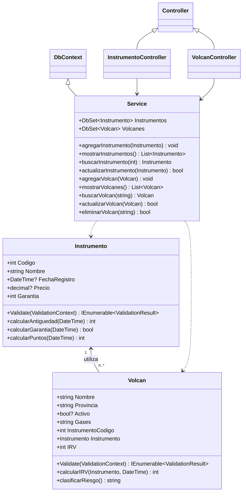
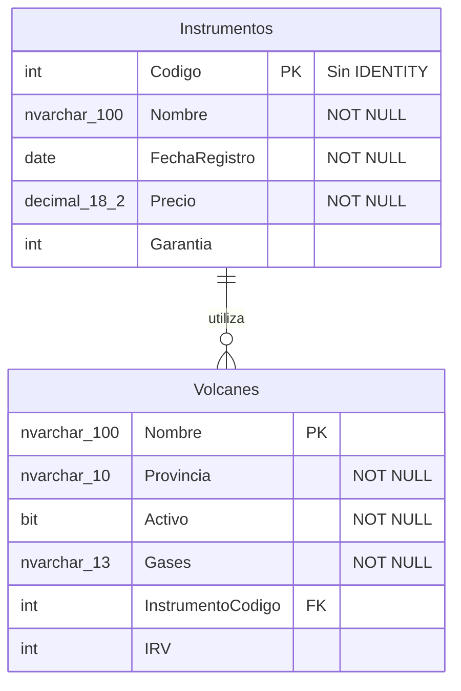
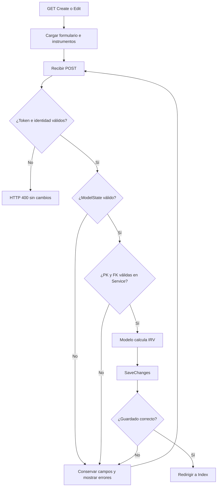

# Cherkessia — Semana 8

Aplicación de Programación II para administrar instrumentos especializados y registros de volcanes del centro de vulcanología Cherkessia. Calcula la antigüedad y cobertura de los instrumentos, y el índice de riesgo volcánico (IRV) de cada volcán.

## Organización HTML sin JavaScript

La interfaz conserva el formato Razor/Bootstrap de las clases 5, 6 y 7, pero no utiliza JavaScript ni validación realizada por el navegador:

- El layout contiene navegación HTML siempre visible; no hay menú desplegable, toggles ni scripts de Bootstrap/jQuery.
- Los formularios usan Tag Helpers, controles HTML estándar y antiforgery tokens.
- La presentación usa Razor para mostrar valores y las vistas parciales para reutilizar campos y detalles.
- Cada acción modifica datos únicamente mediante `POST`; los enlaces `GET` consultan o muestran confirmación, no eliminan.
- Las validaciones obligatorias se ejecutan en los modelos, controladores y servicio mediante C#; HTML conserva los campos enviados y Razor muestra los mensajes devueltos por el servidor.
- Los cálculos de antigüedad, garantía, antigüedad del instrumento e IRV son ejecutados por clases de C#, no mediante JavaScript.
- Bootstrap se usa solamente como CSS; no se carga JavaScript ni componentes interactivos.

Esta separación permite que un formulario manipulado o enviado sin navegador pase exactamente por las mismas reglas que la interfaz normal.

## Funcionalidades

| Módulo | Operaciones |
| --- | --- |
| Instrumentos | Registrar, listar, consultar y actualizar |
| Volcanes | Registrar, listar, consultar, actualizar y eliminar |

Cada volcán se relaciona con un instrumento existente. Los códigos de instrumentos y los nombres de volcanes son claves primarias y no se modifican al actualizar. La eliminación de un volcán conserva su instrumento.

## Tecnologías

| Componente | Tecnología |
| --- | --- |
| Lenguaje | C# |
| Plataforma | .NET 8 |
| Framework web | ASP.NET Core MVC |
| Interfaz | Razor, HTML y Bootstrap CSS |
| ORM | Entity Framework 6.5.2 (EF6) |
| Base de datos | SQL Server Express LocalDB |
| Migraciones | Migraciones automáticas de EF6 |
| Entorno de ejecución con LocalDB | Windows |

La aplicación realiza los cálculos y las validaciones en el servidor y no utiliza JavaScript.

## Reglas de negocio

### Antigüedad y garantía

La antigüedad se calcula en años completos desde la fecha de registro hasta la fecha actual del servidor. El año aumenta al llegar al aniversario; para registros del 29 de febrero, se utiliza el 28 de febrero en años no bisiestos.

La garantía admite de 1 a 5 años:

- **En garantía:** antigüedad ≤ años de garantía.
- **Fuera de garantía:** antigüedad > años de garantía.

Por ejemplo, un instrumento de 5 años con garantía de 5 años sigue cubierto; a los 6 años queda fuera de garantía.

### Índice de riesgo volcánico

**IRV = puntos por actividad + puntos por gases + puntos por antigüedad del instrumento.**

| Variable | Condición | Puntos |
| --- | --- | --- |
| Activo | Sí | 2 |
| Activo | No | 0 |
| Expulsa gases | Poco probable | 1 |
| Expulsa gases | Probable | 2 |
| Expulsa gases | Muy probable | 3 |
| Antigüedad | De 0 a 2 años | 3 |
| Antigüedad | De 3 a menos de 5 años | 2 |
| Antigüedad | 5 años | 1 |
| Antigüedad | Más de 5 años | 0 |

| IRV | Clasificación |
| --- | --- |
| 1–2 | Riesgo Muy Bajo |
| 3–4 | Riesgo Bajo |
| 5–6 | Riesgo Medio |
| 7–8 | Riesgo Alto |

El mínimo posible es 1 y el máximo es 8. El IRV se calcula antes de guardar el volcán y representa su última evaluación guardada. Modificar un instrumento o el paso del tiempo no recalcula automáticamente los volcanes asociados: se recalculan al editar y guardar cada volcán.

### Validaciones

- Código de instrumento: entero positivo, único e ingresado por el operador.
- Nombres: obligatorios y de hasta 100 caracteres. El nombre del volcán no admite espacios al inicio ni al final.
- Fecha de registro: obligatoria, sin hora y no futura.
- Precio en USD: obligatorio, no negativo, con hasta dos decimales y capacidad de almacenamiento `decimal(18,2)`.
- Garantía: entre 1 y 5 años.
- Provincia: San José, Alajuela, Cartago, Heredia, Guanacaste, Puntarenas o Limón.
- Actividad y gases: selección obligatoria dentro de las opciones permitidas.
- Instrumento del volcán: debe existir en la base de datos.
- Formularios que modifican datos: validación del servidor y token antifalsificación.

Si hay errores, el formulario conserva los datos y muestra los mensajes correspondientes. El IRV enviado desde el cliente se ignora.

## Requisitos, reglas y trazabilidad

Entradas: nombre, código, fecha, precio y garantía del instrumento; nombre, provincia, activo, gases e instrumento del volcán. Salidas: listados/detalles, mensajes de validación, antigüedad, estado de garantía, IRV y clasificación. Los errores conservan los campos; el desplegable se recarga. PK y FK se verifican en servidor y BD. IRV nunca se toma del cliente.

| Requisito | Historia | Regla | Componente | Prueba |
| --- | --- | --- | --- | --- |
| Instrumentos agregar / RF-01 | HU-01 | R1 PK única, R2 garantía 1–5 | Instrumento; Service.agregarInstrumento | T1 datos válidos, duplicados, garantía 0/1/5/6 |
| Instrumentos mostrar/actualizar / RF-02 | HU-02 | R3 PK inmutable | InstrumentoController.Index/Details/Edit; Service.actualizarInstrumento | T2 editar datos, manipular PK, inexistente |
| Antigüedad y garantía / RF-03 | HU-03 | R4 años completos y a≤g | Instrumento.calcularAntiguedad/calcularGarantia | T3 aniversarios, 29 febrero, límites de garantía |
| Volcanes agregar / RF-04 | HU-04 | R1 PK única, R5 catálogos, R6 FK existente | Volcan; VolcanController.cargarInstrumentos; Service.agregarVolcan | T4 provincia falsa, lista vacía, FK inexistente, duplicado |
| IRV antes de guardar / RF-05 | HU-05 | R7 puntos y clasificación | Instrumento.calcularPuntos; Volcan.calcularIRV/clasificarRiesgo; Service | T5 combinaciones de activo/gases/antigüedad y extremos 1/8 |
| Volcanes mostrar/actualizar / RF-06 | HU-06 | R3 PK inmutable, R7 recálculo | VolcanController.Index/Details/Edit; Service.actualizarVolcan | T6 cambio permitido, PK manipulada, IRV nuevo |
| Volcanes eliminar / RF-07 | HU-07 | R8 solo POST confirmado | VolcanController.Delete/DeleteConfirmed; Service.eliminarVolcan | T7 GET conserva, POST elimina, instrumento permanece |

### Historias y aceptación

| ID | Historia | Dado / Cuando / Entonces |
| --- | --- | --- |
| HU-01 | Como operador, quiero registrar instrumentos, para seleccionarlos al registrar volcanes | Dado código disponible y valores válidos, cuando guardo, entonces aparece el instrumento. Dada PK duplicada, garantía 0/6, fecha futura o precio negativo, cuando envío, entonces se rechaza sin insertar; 1/5 son garantías válidas |
| HU-02 | Como operador, quiero consultar y actualizar instrumentos, para mantener sus datos | Dado instrumento existente, cuando cambio nombre/precio/fecha/garantía, entonces conserva código. Dada PK diferente entre URL y formulario, entonces HTTP 400; código inexistente en consulta/edición devuelve 404 |
| HU-03 | Como operador, quiero ver antigüedad y garantía, para conocer su cobertura | Dada antigüedad igual a garantía, cuando consulto, entonces En garantía; si mayor, Fuera de garantía. Un día antes del aniversario todavía no aumenta el año; en el aniversario sí |
| HU-04 | Como operador, quiero registrar volcanes con un instrumento, para asociar sus evaluaciones | Dados instrumentos existentes, cuando abro el formulario, entonces aparecen sus nombres. Sin instrumentos se informa que primero hay que registrar uno. Provincia, gases o FK manipulados no se guardan |
| HU-05 | Como operador, quiero calcular IRV, para conocer la clasificación del ejercicio | Dado activo Sí, gases Muy probable e instrumento ≤2, cuando guardo, entonces IRV 8/Alto. Dado No, Poco probable e instrumento >5, entonces IRV 1/Muy Bajo. Un IRV enviado por cliente se ignora |
| HU-06 | Como operador, quiero actualizar volcanes, para mantener sus evaluaciones | Dado volcán existente, cuando cambio activo/gases/provincia/instrumento, entonces conserva nombre PK y recalcula IRV. Un nombre diferente entre URL y formulario devuelve 400; inexistente devuelve 404 |
| HU-07 | Como operador, quiero eliminar volcanes, para retirar registros | Dado registro existente, cuando confirmo por POST con token, entonces desaparece y su instrumento permanece. GET muestra confirmación sin eliminar. Sin token válido se rechaza con 400 |

## Lógica de predicados y C#

Dominios: I instrumentos persistidos, V volcanes persistidos, U actualizaciones aceptadas; t fecha actual. Variables i,j∈I; v,w∈V; u∈U. Funciones c código, n nombre PK, g garantía, a antigüedad en años completos, inst código del instrumento utilizado, R IRV. Predicados EG/FG garantía; A activo; B/MB/M/H clasificaciones. Puntos PI instrumento, PA actividad, PG gases.

| Regla | Fórmula | Interpretación, ejemplo y validación |
| --- | --- | --- |
| R1 | ∀i,j∈I: c(i)=c(j) → i=j; ∀v,w∈V: n(v)=n(w) → v=w | Una PK no identifica dos registros. 101 repetido se rechaza; PK y consultas Any en Service |
| R2 | ∀i∈I: 1≤g(i) ∧ g(i)≤5 | Range en Instrumento.Garantia; 1 y 5 válidos, 0 y 6 inválidos |
| R3 | ∀u∈U: PK(antes(u))=PK(después(u)) | Edit compara identidad; Service copia solo campos editables. Hidden por sí solo no protege |
| R4 | ∀i∈I: (EG(i,t) → a(i,t)≤g(i)) ∧ (a(i,t)≤g(i) → EG(i,t)) | Equivalencia expresada en ambas direcciones: a=g cubierto; calcularGarantia |
| R4 | ∀i∈I: (FG(i,t) → a(i,t)>g(i)) ∧ (a(i,t)>g(i) → FG(i,t)) | a=6,g=5 fuera; no se confunde cobertura con puntuación |
| R5 | ∀v∈V: provincia(v)∈Provincias ∧ gases(v)∈OpcionesGases | Los conjuntos están definidos una sola vez en Volcan y se reutilizan en Razor; Validate valida valores manipulados |
| R6 | ∀v∈V ∃i∈I: inst(v)=c(i) | FK y Service.validarVolcan; código inexistente se rechaza |
| R7 | ∀i∈I: (0≤a≤2 → PI=3) ∧ (3≤a<5 → PI=2) ∧ (a=5 → PI=1) ∧ (a>5 → PI=0) | calcularPuntos; límites 2/3/4/5/6 producen 3/2/2/1/0 |
| R7 | ∀v∈V: (A(v) → PA=2) ∧ (¬A(v) → PA=0) | Activo es bool? obligatorio; selección ausente no equivale a No |
| R7 | ∀v∈V: (gases=PocoProbable → PG=1) ∧ (gases=Probable → PG=2) ∧ (gases=MuyProbable → PG=3) | calcularIRV usa switch y rechaza valores fuera de catálogo |
| R7 | ∀v∈V: R(v)=PA(v)+PG(v)+PI(inst(v),t) | Service llama el cálculo del modelo antes de SaveChanges; IRV tiene setter privado y no está en Bind |
| R7 | ∀v∈V: (1≤R≤2 → MB) ∧ (3≤R≤4 → B) ∧ (5≤R≤6 → M) ∧ (7≤R≤8 → H) | clasificarRiesgo; límites 2/3/4/5/6/7/8 cubiertos |
| R8 | ∀u: elimina(u) → POST(u) ∧ tokenValido(u) | Condiciones necesarias, no suficientes: también deben existir registro y BD disponible |

`calcularAntiguedad` usa diferencia de años y resta uno si todavía no llegó el aniversario. Las fechas sin registro o posteriores a t son inválidas. No se usa una condición «campos válidos → guardado seguro»: aún pueden fallar token, PK/FK o persistencia.

## Diagramas

El UML modela clases y métodos; el ER modela tablas y columnas. Los catálogos son listas estáticas, no tablas adicionales. Métodos de cálculo no son columnas. Antigüedad, garantía y clasificación se derivan; solo IRV se persiste como resultado del último guardado.



`IRV` tiene lectura pública y escritura privada. Los controladores tienen Index, Details, Create GET/POST y Edit GET/POST; VolcanController también Delete GET y DeleteConfirmed POST. HomeController conserva Index, Privacy y Error. El contexto se libera en Dispose de cada controlador de datos.



Las propiedades nullable de fecha/precio/activo permiten distinguir campo no enviado y mostrar Required; EF6 usa Required para columnas NOT NULL. La relación se configura en OnModelCreating y no elimina en cascada. EF6 mantiene además su tabla técnica `__MigrationHistory`, no una entidad del dominio.



## Organización MVC

| Ubicación | Responsabilidad |
| --- | --- |
| `Models/` | Entidades, validaciones, cálculos de antigüedad, garantía e IRV |
| `Views/` | Formularios, listados y detalles en Razor |
| `Controllers/` | Recibir solicitudes, validar formularios y devolver vistas o redirecciones |
| `Services/Service.cs` | Contexto EF6, relaciones y operaciones CRUD |
| `Migrations/Configuration.cs` | Configuración de migraciones automáticas |
| `wwwroot/` | Estilos CSS y licencia de Bootstrap |
| `Properties/launchSettings.json` | Perfiles HTTP y HTTPS |
| `appsettings.json` | Conexión y configuración de registros |
| `Program.cs` | Servicios, middleware y rutas |
| `../Verification/` | Pruebas del dominio y de integración HTTP |
| `../../../.github/workflows/class-08.yml` | Verificación automatizada en Windows |

Los modelos utilizan campos privados, propiedades, constructores y DataAnnotations. `Service` hereda de `DbContext` y contiene los `DbSet` y métodos CRUD. Los controladores liberan el contexto mediante `Dispose`.

La ruta MVC es `{controller=Home}/{action=Index}/{id?}`. Los instrumentos utilizan su código en la ruta; los volcanes pasan su nombre mediante `?nombre=...` para admitir espacios, acentos y barras. Se incluyen Home, Privacy y Error, junto con el layout y la navegación.

### Flujo de una solicitud

1. El GET presenta el formulario y su token antifalsificación.
2. El POST convierte los campos y ejecuta las validaciones del modelo.
3. El controlador comprueba `ModelState`.
4. `Service` valida la entidad y comprueba sus claves.
5. El modelo calcula el IRV antes de `SaveChanges`.
6. Tras guardar, el controlador redirige al listado. Si hay errores, devuelve el formulario.

## Instalación y ejecución

### Requisitos

- SDK .NET 8 compatible.
- SQL Server Express LocalDB instalado en Windows.
- Visual Studio con la carga **ASP.NET and web development**, si se utiliza el IDE.
- Para abrir `.slnx`: Visual Studio 17.14 o posterior; también puede abrirse directamente `Cherkessia.csproj`.

### Descargar y ejecutar

Desde la raíz del repositorio, con los cambios locales previamente conservados:

```powershell
git switch main
git pull --ff-only origin main
SqlLocalDB start MSSQLLocalDB
dotnet restore classes/class-08/Cherkessia/Cherkessia.csproj
dotnet build classes/class-08/Cherkessia/Cherkessia.csproj --configuration Release
dotnet run --project classes/class-08/Cherkessia/Cherkessia.csproj --launch-profile http
```

Abrir **http://localhost:5280**. Registrar primero un instrumento y después un volcán.

| Página | Ruta |
| --- | --- |
| Inicio | `/` |
| Instrumentos | `/Instrumento` |
| Volcanes | `/Volcan` |
| Privacidad | `/Home/Privacy` |
| Error | `/Home/Error` |

En Visual Studio, abrir `classes/class-08/Cherkessia/Cherkessia.slnx` o el `.csproj`, seleccionar Cherkessia como proyecto de inicio y ejecutar el perfil `http`. El perfil `https` utiliza el puerto 7280; para confiar el certificado de desarrollo:

```powershell
dotnet dev-certs https --trust
```

### Conexión y migraciones

`appsettings.json` define la conexión `BloggingDatabase`:

```text
Data Source=(localdb)\MSSQLLocalDB;Initial Catalog=Cherkessia;Integrated Security=True;
```

`Service` recibe la conexión mediante `IConfiguration`. También puede sobrescribirse con la variable de entorno `ConnectionStrings__BloggingDatabase`.

La primera consulta a la base de datos ejecuta las migraciones automáticas de EF6. La pérdida automática de datos está deshabilitada. Como alternativa, desde Package Manager Console de Visual Studio, con Cherkessia como proyecto predeterminado:

```powershell
Update-Database -ConfigurationTypeName Cherkessia.Migrations.Configuration -ConnectionString "Data Source=(localdb)\MSSQLLocalDB;Initial Catalog=Cherkessia;Integrated Security=True;" -ConnectionProviderName "System.Data.SqlClient" -Verbose
```

Las migraciones ya están configuradas; no es necesario ejecutar `Enable-Migrations`. Los comandos `dotnet ef` corresponden a EF Core, no al ORM de este proyecto.

En SQL Server Object Explorer, conectar a `(localdb)\MSSQLLocalDB` y revisar:

```sql
USE Cherkessia;
SELECT Codigo, Nombre, FechaRegistro, Precio, Garantia FROM dbo.Instrumentos;
SELECT Nombre, Provincia, Activo, Gases, InstrumentoCodigo, IRV FROM dbo.Volcanes;
```

### Trabajo desde WSL

WSL permite editar y compilar el proyecto con un SDK compatible. La ejecución con la conexión LocalDB se realiza en Windows.

Una carpeta de Windows como `C:\GitHub\programming-ii` se accede desde WSL mediante `/mnt/c/GitHub/programming-ii`. Si ambos entornos usan esa carpeta, comparten los archivos. Para comprobar la ubicación y el estado:

```bash
pwd
wslpath -w "$PWD"
git branch --show-current
git status --short
```

Si se utilizan clones separados, sincronizar mediante commits y `git pull --ff-only`; no copiar `bin/`, `obj/` ni los archivos de la base de datos como código fuente.

## Pruebas

Desde la raíz del repositorio:

```powershell
dotnet run --project classes/class-08/Verification/Verification.csproj --configuration Release
python classes/class-08/Verification/http_checks.py
```

Las pruebas HTTP requieren Windows, LocalDB, Python y una compilación Release previa. Crean una base aislada `Cherkessia_Verification_<uuid>`, reinician la aplicación para comprobar persistencia y generan `Verification/http-server.log`. La base de prueba queda disponible para inspección local; en GitHub Actions desaparece con la máquina de ejecución.

### Resultados verificados

[Ver ejecución en GitHub Actions](https://github.com/eng-djc/programming-ii/actions/runs/41258618033).

| Verificación | Resultado |
| --- | --- |
| Compilación Release, incluido Razor | 0 errores y 0 advertencias |
| Reglas del dominio | 152 comprobaciones aprobadas |
| HTTP y LocalDB | 83 comprobaciones aprobadas |
| Persistencia | Registros e IRV conservados tras reiniciar |
| Validaciones | Entradas inválidas, duplicados y FK inexistentes rechazados |
| Claves primarias | Intentos de cambiarlas desde el formulario rechazados |
| Antifalsificación | Solicitudes de creación y eliminación sin token rechazadas |
| Eliminación | GET conserva el registro; POST elimina el volcán y conserva el instrumento |
| Páginas | Home, Privacy, Error y páginas del flujo accesibles |
| Interfaz sin JavaScript | Archivos y HTML examinado sin scripts ni eventos ejecutables |

Estos resultados corresponden a Windows Server 2025 en GitHub Actions. La ejecución desde Visual Studio, el comando manual de Package Manager Console y la revisión visual requieren comprobación en el equipo donde se instale.

## Consideraciones de uso

- La fecha y zona horaria del servidor determinan la antigüedad.
- El IRV se actualiza al guardar el volcán, no automáticamente al cambiar un instrumento.
- Las ediciones no incorporan control de concurrencia optimista: prevalece el último guardado.
- La aplicación no incluye autenticación ni perfiles de usuario.
