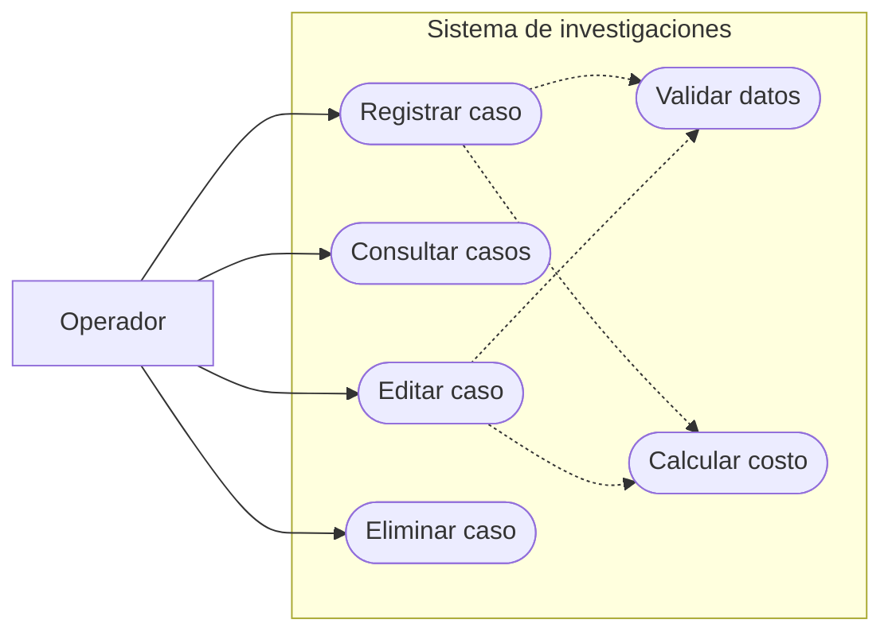
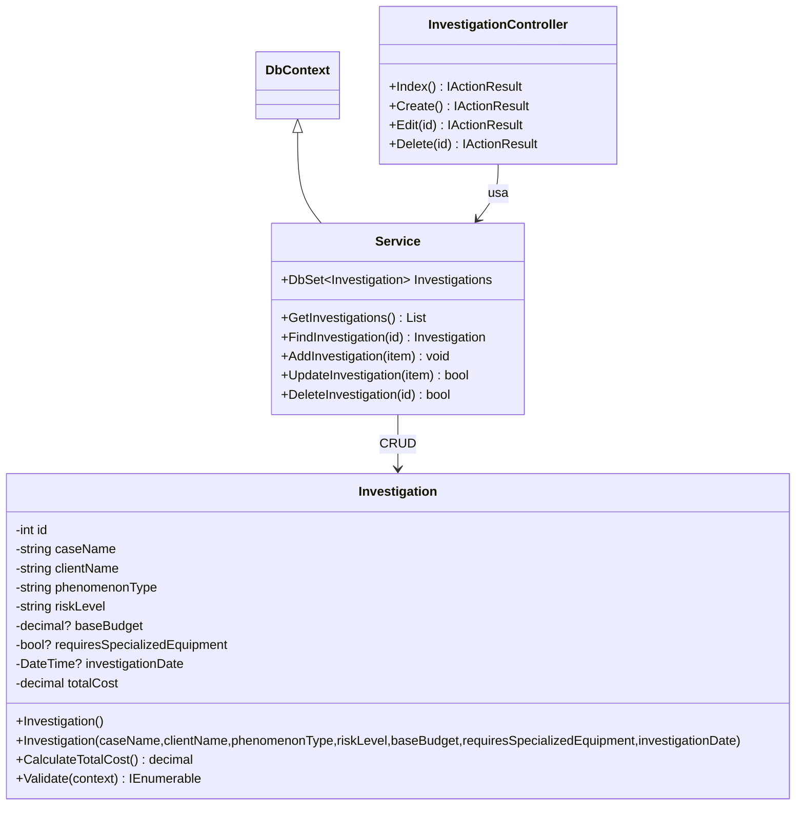
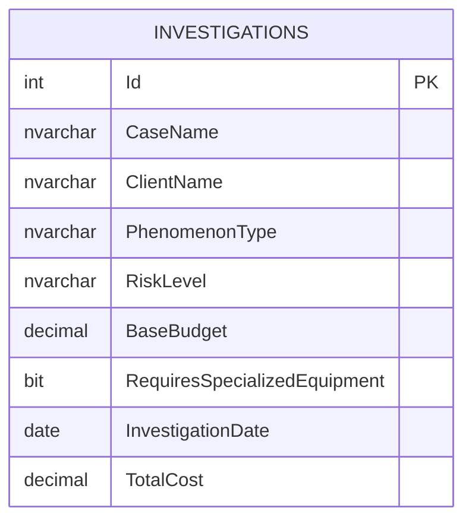

# ParanormalAgency — Examen Semana 09

## Enunciado

Una agencia de investigaciones paranormales requiere una aplicación web para registrar, consultar, actualizar y eliminar investigaciones. Cada caso incluye nombre del caso, cliente, tipo de fenómeno (Aparición, Poltergeist, Actividad demoníaca u Objeto maldito), riesgo (Bajo, Medio, Alto o Crítico), presupuesto base en USD, necesidad de equipo especializado y fecha de investigación. El sistema calcula y muestra el costo total.

**Costo total = presupuesto base + incremento por fenómeno + adicional por riesgo + incremento por equipo especializado.**

| Fenómeno | Incremento |
|---|---:|
| Aparición | 15% del presupuesto base |
| Poltergeist | 25% |
| Actividad demoníaca | 45% |
| Objeto maldito | 30% |

| Riesgo | Adicional USD |
|---|---:|
| Bajo | 500 |
| Medio | 1.000 |
| Alto | 2.000 |
| Crítico | 4.000 |

El equipo especializado agrega 20% del presupuesto base cuando se selecciona Sí. El cálculo se ejecuta en el modelo al crear y editar.

## Rúbrica — Distribución del puntaje

| Criterio | Puntos | Subcriterios oficiales | Evidencia |
|---|---:|---|---|
| Clase lógica | 5 | Atributos; constructores; propiedades | Models/Investigation.cs |
| Cálculos matemáticos | 5 | Calcular costo en clase lógica; mostrar costo | Investigation.CalculateTotalCost; Views/Investigation/Index.cshtml |
| Controlador | 10 | Index; Create; Delete; Edit | Controllers/InvestigationController.cs |
| Vistas | 10 | Mostrar; validaciones; etiquetas; submit/reset; precarga | Views/Investigation/ |
| Base de datos / Service | 10 | Agregar; mostrar; eliminar; actualizar | Services/Service.cs |
| Aspectos varios | 5 | Navegación; formato; español; quitar Home/Privacy | Views/Shared/_Layout.cshtml; Program.cs |
| Defensa | 55 | Dominio del tema; responder preguntas | Pendiente de defensa |
| **Total** | **100** | | |

## Notas importantes — Criterios de aceptación

| ID | Condición oficial | Estado |
|---|---|---|
| NI-01 | Create y Edit con igual estructura y distribución visual, controles correctos y submit/reset | Pendiente de validación de ejecución y/o revisión visual |
| NI-02 | Fecha de investigación sin hora | Pendiente de validación de ejecución y/o revisión visual |
| NI-03 | Todos los campos obligatorios y formulario acorde a la imagen | Pendiente de validación de ejecución y/o revisión visual |
| NI-04 | Registrar, mostrar todos los datos, editar y eliminar | Pendiente de validación de ejecución y/o revisión visual |
| NI-05 | Calcular costo al crear y editar | Pendiente de validación de ejecución y/o revisión visual |
| NI-06 | Cálculo dentro de la clase lógica | Pendiente de validación de ejecución y/o revisión visual |
| NI-07 | Navegación correcta | Pendiente de validación de ejecución y/o revisión visual |
| NI-08 | Eliminar Home y Privacy | Pendiente de validación de ejecución y/o revisión visual |
| NI-09 | Aplicación completamente en español | Pendiente de validación de ejecución y/o revisión visual |

## Matriz de trazabilidad y control de cambios

**Jerarquía de fuentes:** examen saneado (funcionalidad y rúbrica) > Class 08 Cherkessia (estructura MVC y formato académico) > Class 07 EGamer (referencia secundaria). Las diferencias respecto a Class 08 solo se aceptan si están exigidas por el examen o son indispensables para implementar el dominio paranormal.

| Cambio o decisión | Requisito / historia | Nota o criterio de rúbrica | Evidencia en código | Justificación | Validación |
|---|---|---|---|---|---|
| Inicio en lista de investigaciones; no Home/Privacy | RF-08, RF-12 | NI-07, NI-08; Aspectos varios (5) | `Program.cs`, `Views/Shared/_Layout.cshtml` | Excepción explícita a la plantilla Class 08 por exigencia del examen | Navegación observada; revisar ausencia de rutas/enlaces innecesarios |
| Modelo con atributos, propiedades y dos constructores | RF-01, RF-02; RNF-01 | Clase lógica (5) | `Models/Investigation.cs` | Mantener patrón de Class 08 y adaptar los campos al examen | Compilación aprobada; revisión de propiedades pendiente |
| Porcentajes, riesgo fijo y equipo sobre presupuesto base | RF-03 a RF-07 | NI-05, NI-06; Cálculos (5) | `Models/Investigation.cs` | Fórmula exacta del examen, sin cálculo en controlador | Pruebas de combinaciones pendientes |
| CRUD mediante controlador y Service EF6 | RF-01, RF-08 a RF-10; RNF-01, RNF-03 | NI-04; Controlador (10); Service (10) | `Controllers/InvestigationController.cs`, `Services/Service.cs` | Seguir la separación MVC y DbContext de Class 08 | Index cargó en Windows; Create/Edit/Delete pendientes |
| Controles radio, select, number y date obligatorios | RF-02 a RF-06, RF-11 | NI-01, NI-03; Vistas (10) | `Views/Investigation/_Form.cshtml` | Controles definidos por el examen; mismo formulario para Create/Edit | Revisión visual y validaciones pendientes |
| Fecha sin hora | RF-06; RNF-09 | NI-02 | `Models/Investigation.cs`, `Views/Investigation/Index.cshtml` | La hora no aporta valor al caso y el examen pide fecha | Prueba de persistencia y visualización pendiente |
| Estilos y estructura HTML de Class 08 | RNF-05, RNF-12 | NI-01; Aspectos varios (5) | `Views/Shared/_Layout.cshtml`, `wwwroot/css/site.css`, vistas | No personalizar la plantilla sin requisito | Comparación visual parcial; Create/Edit pendientes |
| Etiquetas, botones y mensajes en español | RF-11, RF-12; RNF-04 | NI-09; Aspectos varios (5) | Vistas, modelos y controlador | Requisito explícito del examen | Revisión integral pendiente |
| Protección antifalsificación y campos enlazados explícitamente | RNF-07, RNF-11 | Integridad de operaciones CRUD | `Controllers/InvestigationController.cs`, vistas POST | Convención de seguridad existente en Class 08; no agrega funciones ajenas | Pruebas POST pendientes |
| Documentación y pruebas vinculadas a rúbrica | RNF-10, RNF-12 | Rúbrica completa (100) | `README.md` | Facilitar defensa y demostrar cumplimiento sin atribuir puntos no comprobados | Defensa y pruebas pendientes |

**Regla para cambios futuros:** antes de modificar un archivo, identificar el RF/RNF, la historia de usuario, el criterio de aceptación, el punto de rúbrica, el archivo afectado y la prueba que verificará el cambio. Si no existe justificación, no introducir la modificación. Los estados «implementado», «compilado», «probado» y «aprobado» no son equivalentes; registrar solo evidencias observadas.

## Aclaración del requisito de fecha — fuente del examen

**Texto oficial del enunciado:** «Fecha de investigación: campo de fecha». **Nota importante 2:** «La fecha de investigación no debe mostrar la hora».

**RF-06 — Registro de fecha de investigación.** Como operador de la agencia, quiero registrar la fecha de una investigación para identificarla en el expediente. **Aceptación:** campo obligatorio de tipo HTML `date` en Create/Edit, con el valor recuperado correctamente al editar; la fecha se muestra sin componente de hora en Index.

**RNF-09 — Presentación de fecha.** La interfaz debe representar la fecha sin hora. El texto `mm/dd/yyyy` o `dd/mm/aaaa` que aparece dentro del selector nativo puede variar según el navegador y la configuración regional del usuario; no es un requisito que deba implementarse con JavaScript. El listado muestra `dd/MM/yyyy`.

**NI-02 — Restricción de la rúbrica.** No se debe mostrar hora en el campo de fecha de investigación.

**Alcance semántico:** el PDF no precisa si la fecha corresponde a la visita programada o a la ejecución efectiva de la investigación. No indica que sea la fecha de aparición del fenómeno. Por fidelidad al enunciado, la etiqueta se mantiene «Fecha de investigación»; no se agrega fecha/hora del suceso ni se impone una interpretación de agenda no exigida.

**Sin JavaScript:** los controles y las restricciones nativas de HTML5 funcionan sin scripts. Los mensajes de validación emergentes del navegador pueden aparecer en inglés si el idioma del navegador es inglés; la aplicación no puede forzar su traducción sin alterar el mecanismo de validación. La validación de negocio y los mensajes definidos por la aplicación deben permanecer en español y ejecutarse en el servidor.

## Requerimientos funcionales

| ID | Requerimiento | Historia de usuario | Criterio de aceptación |
|---|---|---|---|
| RF-01 | Registrar investigaciones: Registrar un caso con todos los campos obligatorios | Como operador, quiero registrar un caso con todos los campos obligatorios para administrar correctamente los casos. | El registro se almacena y aparece en Index |
| RF-02 | Identificar caso y cliente: Capturar los nombres del caso y del cliente | Como operador, quiero capturar los nombres del caso y del cliente para administrar correctamente los casos. | Ambos campos son obligatorios |
| RF-03 | Seleccionar fenómeno: Elegir uno de los cuatro fenómenos oficiales | Como operador, quiero elegir uno de los cuatro fenómenos oficiales para administrar correctamente los casos. | Radio de selección única |
| RF-04 | Seleccionar riesgo: Elegir Bajo, Medio, Alto o Crítico | Como operador, quiero elegir bajo, medio, alto o crítico para administrar correctamente los casos. | Lista desplegable obligatoria |
| RF-05 | Presupuesto y equipo: Indicar presupuesto en USD y equipo especializado | Como operador, quiero indicar presupuesto en usd y equipo especializado para administrar correctamente los casos. | Número no negativo y radio Sí/No |
| RF-06 | Fecha de investigación: Seleccionar la fecha del caso | Como operador, quiero seleccionar la fecha del caso para administrar correctamente los casos. | Campo date sin hora |
| RF-07 | Costo total: Calcular automáticamente el costo final | Como operador, quiero calcular automáticamente el costo final para administrar correctamente los casos. | Fórmula del PDF implementada en Model |
| RF-08 | Listado: Consultar todos los casos y sus datos | Como operador, quiero consultar todos los casos y sus datos para administrar correctamente los casos. | Index muestra todos los campos y costo |
| RF-09 | Edición: Actualizar un caso existente | Como operador, quiero actualizar un caso existente para administrar correctamente los casos. | Edit precarga datos y recalcula costo |
| RF-10 | Eliminación: Retirar un caso existente | Como operador, quiero retirar un caso existente para administrar correctamente los casos. | Delete solicita confirmación y elimina por POST |
| RF-11 | Validación: Evitar guardar formularios incompletos | Como operador, quiero evitar guardar formularios incompletos para administrar correctamente los casos. | Mensajes de error en español |
| RF-12 | Navegación: Moverse entre operaciones | Como operador, quiero moverse entre operaciones para administrar correctamente los casos. | Enlaces de retorno y menú funcional |

## Requerimientos no funcionales

| ID | Requerimiento | Historia de usuario | Criterio de aceptación |
|---|---|---|---|
| RNF-01 | MVC: Separar modelo, vista y controlador | Como desarrollador, quiero separar modelo, vista y controlador para contar con una aplicación confiable y defendible. | Estructura ASP.NET Core MVC |
| RNF-02 | Visual Studio: Abrir y ejecutar solución | Como desarrollador, quiero abrir y ejecutar solución para contar con una aplicación confiable y defendible. | Proyecto .NET 8 y archivo de solución |
| RNF-03 | Persistencia: Conservar registros entre ejecuciones | Como desarrollador, quiero conservar registros entre ejecuciones para contar con una aplicación confiable y defendible. | EF6 6.5.2 y SQL Server LocalDB |
| RNF-04 | Idioma: Mostrar toda la interfaz en español | Como desarrollador, quiero mostrar toda la interfaz en español para contar con una aplicación confiable y defendible. | Etiquetas, mensajes y botones en español |
| RNF-05 | Consistencia visual: Mantener Create/Edit uniformes | Como desarrollador, quiero mantener create/edit uniformes para contar con una aplicación confiable y defendible. | Ambos comparten _Form.cshtml |
| RNF-06 | Tecnologías: Conservar HTML, Razor y Bootstrap CSS | Como desarrollador, quiero conservar html, razor y bootstrap css para contar con una aplicación confiable y defendible. | Sin JavaScript |
| RNF-07 | Integridad: Validar entradas antes de guardar | Como desarrollador, quiero validar entradas antes de guardar para contar con una aplicación confiable y defendible. | DataAnnotations y validación de Service |
| RNF-08 | Precisión: Evitar errores monetarios | Como desarrollador, quiero evitar errores monetarios para contar con una aplicación confiable y defendible. | Decimal con precisión 18,2 |
| RNF-09 | Fecha: No mostrar hora innecesaria | Como desarrollador, quiero no mostrar hora innecesaria para contar con una aplicación confiable y defendible. | Fecha dd/MM/yyyy en listado |
| RNF-10 | Mantenibilidad: Documentar lógica crítica | Como desarrollador, quiero documentar lógica crítica para contar con una aplicación confiable y defendible. | Comentarios profesionales en español |
| RNF-11 | Formularios seguros: Evitar cambios no previstos | Como desarrollador, quiero evitar cambios no previstos para contar con una aplicación confiable y defendible. | Antiforgery y Bind explícito |
| RNF-12 | Fidelidad académica: Conservar convenciones de Class 08 | Como desarrollador, quiero conservar convenciones de class 08 para contar con una aplicación confiable y defendible. | Model/Service/Controller/Views y EF6 |

## UML — Casos de uso

## UML — Clases

## Diagrama de base de datos

## Auditoría visual y pruebas observadas — 07/11/2026

**Cambio de presentación en Index:** la tabla de nueve columnas conserva `table table-striped` de Class 08 y se envuelve en `table-responsive` de Bootstrap para permitir desplazamiento horizontal en pantallas estrechas. No se modifican campos, encabezados, lógica, navegación, estilos propios ni scripts. **Trazabilidad:** RF-08 (mostrar todos los datos), RNF-05 (consistencia visual), RNF-06 (Bootstrap sin JavaScript), RNF-12 (fidelidad a Class 08), NI-04 (mostrar todos los datos), rúbrica de Vistas (10) y Aspectos varios (5). **Historia de usuario:** Como operador, quiero consultar las nueve columnas y acceder a Actualizar/Eliminar incluso en una ventana estrecha para administrar los casos sin perder información. **Aceptación pendiente:** comprobar visualmente que las acciones se alcanzan mediante desplazamiento horizontal, sin recorte.

**Evidencia manual aportada en capturas (no sustituye pruebas automatizadas):**

| Prueba | Evidencia observada | Estado |
|---|---|---|
| Create con datos válidos | Registros visibles en Index y costo calculado | Aprobada en prueba manual |
| Index | Datos y costo visibles; fecha sin hora | Aprobada en prueba manual |
| Edit | Presupuesto actualizado a 1.000,00; costo recalculado a 3.350,00 | Aprobada en prueba manual |
| Delete | Confirmación y posterior lista vacía | Aprobada en prueba manual |
| HTML5 required | Navegador impidió envío con cada uno de los siete campos vacíos | Aprobada en navegador |
| Presupuesto negativo en servidor | Con `novalidate` temporal en DevTools, `-3` devolvió mensaje «Ingrese un presupuesto válido en USD.» sin redirigir a Index | Aprobada en servidor; consulta independiente a BD pendiente |
| Persistencia entre reinicios | No se aportó reinicio controlado | Pendiente |
| Desplazamiento horizontal en Index | Ajuste Bootstrap incorporado | Pendiente de verificación visual |
| Defensa oral | No realizada | Pendiente |

**Nota de integridad:** las pruebas de validación HTML5 no prueban por sí mismas la validación del servidor. La captura del rechazo de `-3` sí muestra un error devuelto en la respuesta del formulario. No se asigna puntaje definitivo a los criterios de la defensa.

## Configuración y ejecución

| Componente | Tecnología |
|---|---|
| Lenguaje | C# |
| Framework | .NET 8, ASP.NET Core MVC |
| ORM | Entity Framework 6.5.2 (no EF Core) |
| Base de datos | SQL Server Express LocalDB |
| UI | Razor, HTML y Bootstrap CSS; sin JavaScript |

1. Abrir `ParanormalAgency.slnx` en una versión de Visual Studio compatible con soluciones SLNX y .NET 8; alternativamente abrir `ParanormalAgency.csproj`.
2. Verificar que SQL Server LocalDB esté instalado en Windows y que la instancia `MSSQLLocalDB` exista.
3. Verificar `ConnectionStrings:BloggingDatabase` en `appsettings.json`; la base independiente se llama `ParanormalAgency`.
4. Restaurar paquetes NuGet y compilar.
5. Las migraciones automáticas de EF6 están configuradas en `Migrations/Configuration.cs` y se aplican mediante el inicializador `MigrateDatabaseToLatestVersion` al utilizar el contexto.
6. Para administrar migraciones desde Package Manager Console, utilizar los comandos **de EF6**, no los de EF Core. `Enable-Migrations` solo corresponde si aún no existe la configuración; no duplicarla. `Update-Database -Verbose` requiere confirmar que la herramienta EF6 y la configuración del proyecto sean compatibles.
7. Ejecutar y verificar la tabla `Investigations`, CRUD y persistencia. LocalDB es una tecnología de Windows; WSL permite editar archivos pero no sustituye la prueba de integración con LocalDB en Windows.

## Pruebas de aceptación

| ID | Requisito | Caso | Resultado esperado | Estado |
|---|---|---|---|---|
| T-01 | RF-01 | Registrar caso completo | Registro persistido | No ejecutado |
| T-02 | RF-07 | Poltergeist, Alto, USD 1000, equipo Sí | USD 3450.00 | No ejecutado |
| T-03 | RF-09 | Editar fenómeno/riesgo | Costo recalculado | No ejecutado |
| T-04 | RF-10 | Confirmar eliminación | Registro eliminado | No ejecutado |
| T-05 | RF-11 | Enviar formulario incompleto | Errores en español | No ejecutado |
| T-06 | RNF-09 | Mostrar fecha | Solo dd/MM/yyyy | No ejecutado |
| T-07 | RNF-03 | Reiniciar aplicación | Registros conservados | No ejecutado |
| T-08 | RNF-02 | Abrir solución en Visual Studio | Compilación y ejecución | No ejecutado |
